<p align="center">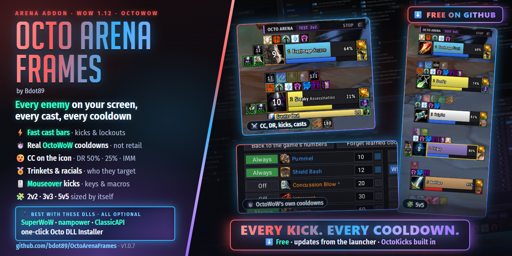</p>

<p align="center">
  <a href="https://github.com/bdot89/OctoArenaFrames/releases/latest"></a>
  
  
</p>

# ⚔️ OctoArenaFrames

**Arena frames made for OctoWoW.** Every enemy on your screen: every cast, every kick, every
cooldown. The **OctoKicks** interrupt tracker is built in.

- ⚡ **Fast cast bars** with kicks and lockouts (`LOCKED: Frost 5.2`)
- ⏱️ **OctoWoW's own cooldowns**, read from the game's spell data, not retail
- 😵 **Crowd control on the class icon**, with a timer and DR (50% · 25% · IMM)
- 🏅 **PvP trinket and racial**, bright when ready
- 🎯 **Who each enemy targets**, `> YOU` in red
- 🖱️ **Mouseover casting**: mouse over a frame and press any offensive spell or kick
- 🧩 **2v2 · 3v3 · 5v5** found by itself, each with its own place and size
- 🔍 **Finds the enemy team before the gates open**
- 🏟️ **OctoKicks built in**: tournament mode, BG / World rows, interrupt bar

## 📸 Screenshots

<p align="center">
  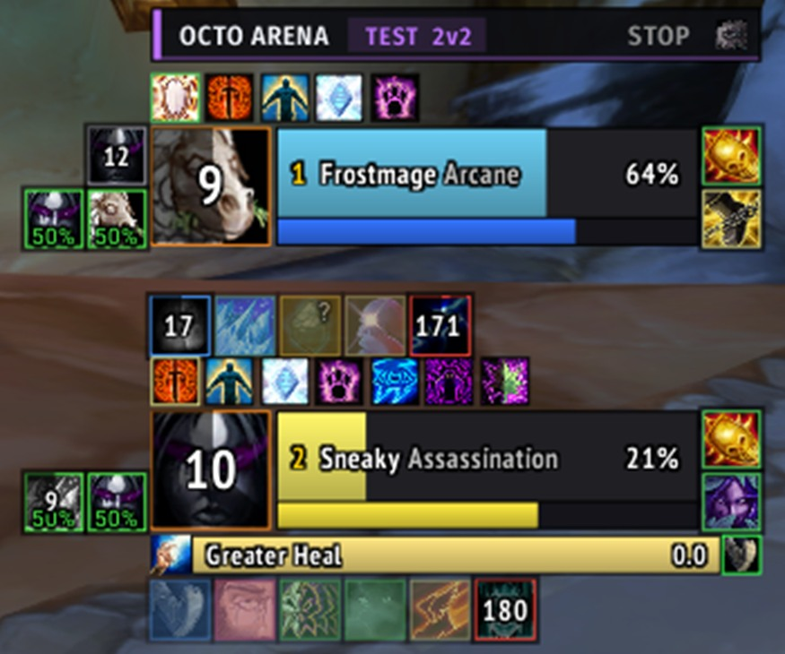
  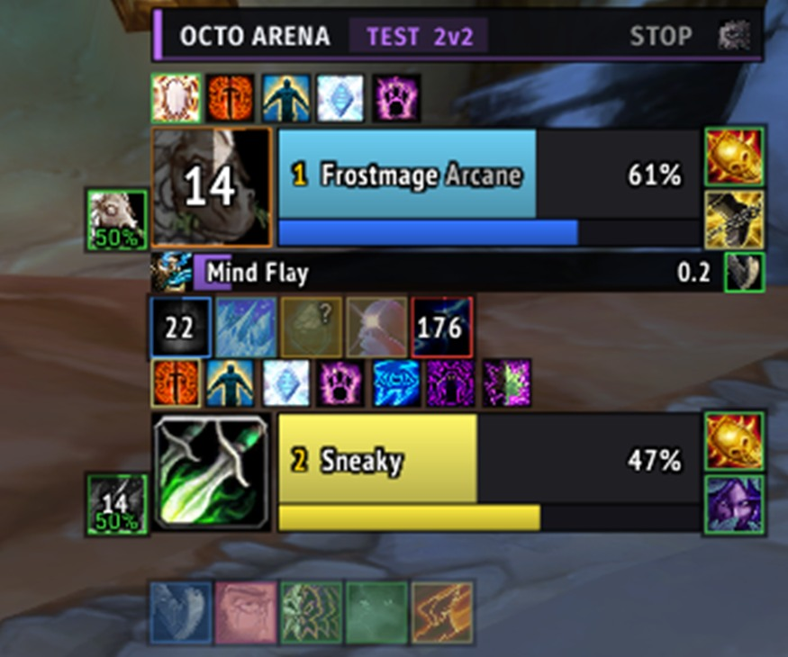
</p>
<p align="center">
  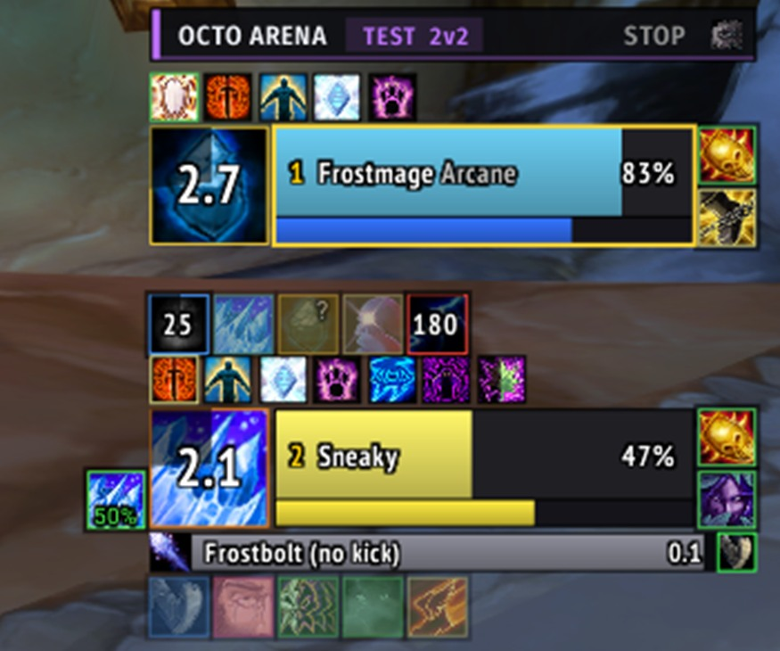
  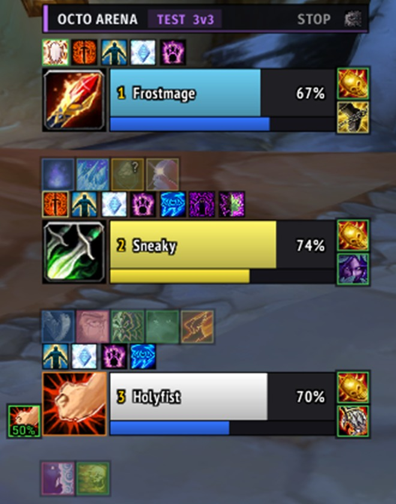
</p>
<p align="center">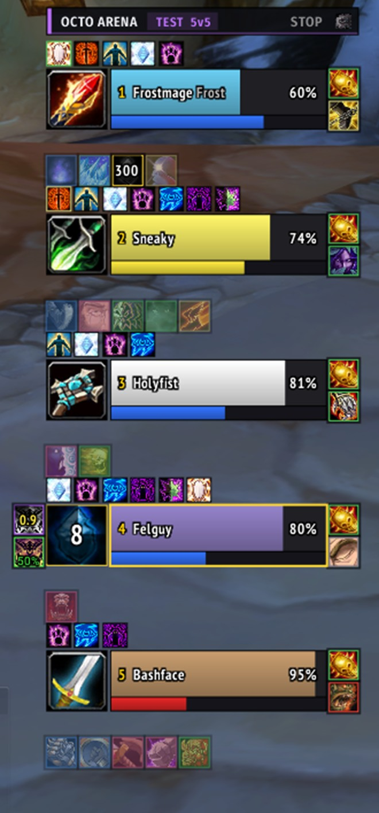</p>

<details>
<summary><b>⚙️ The options window</b> (click to open)</summary>
<p align="center">
  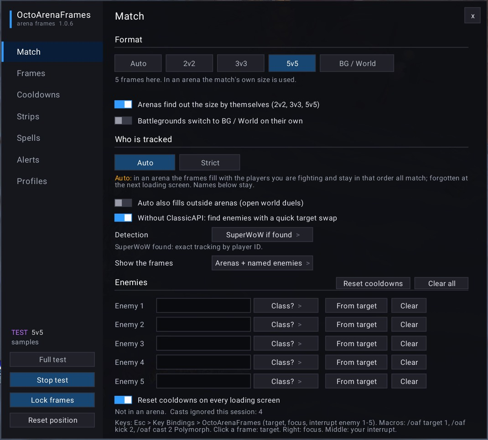
  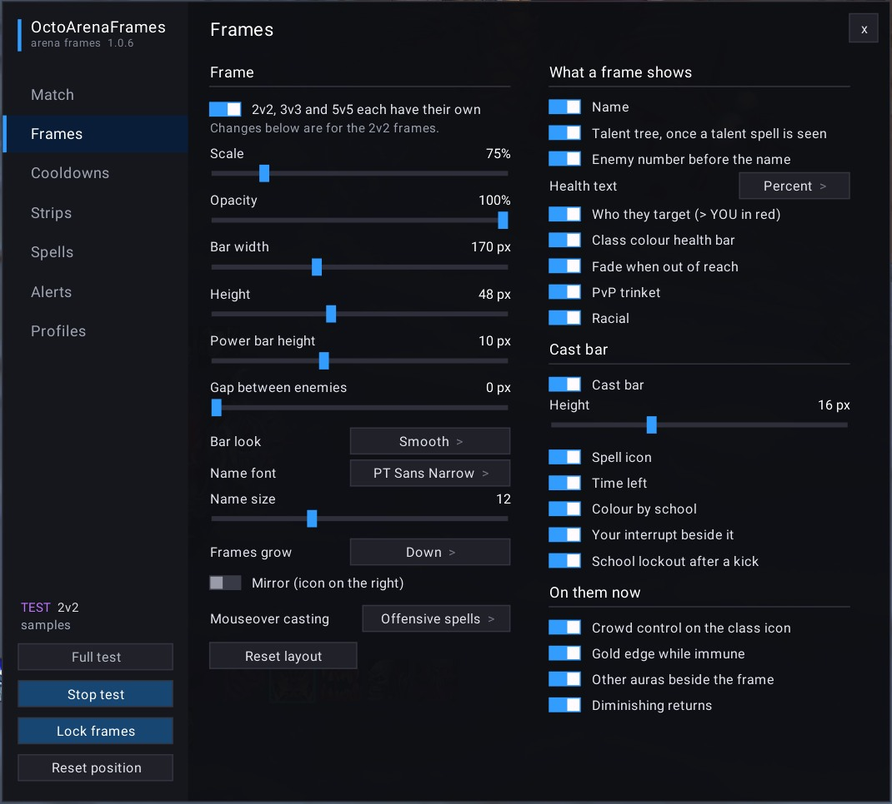
  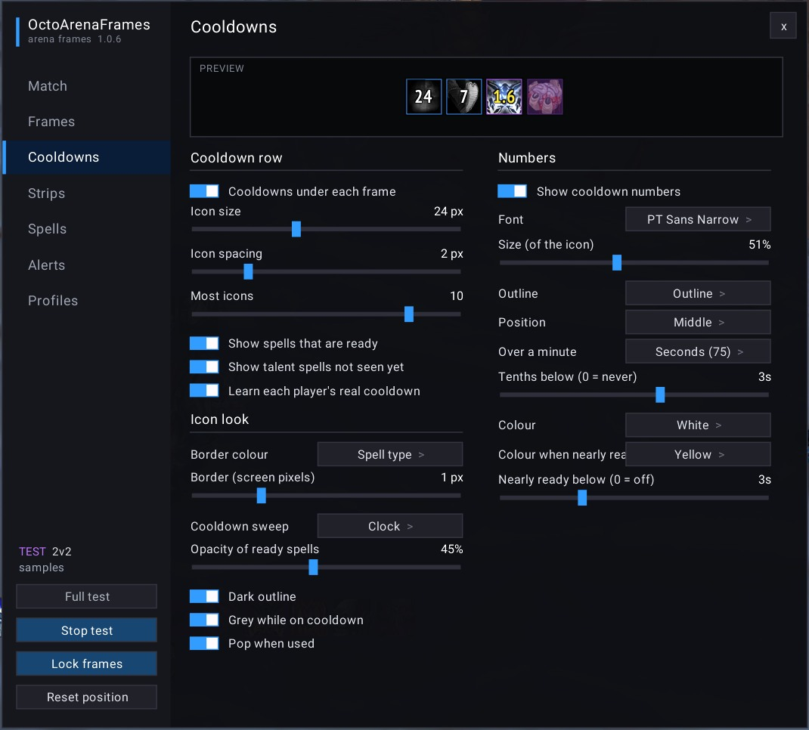
  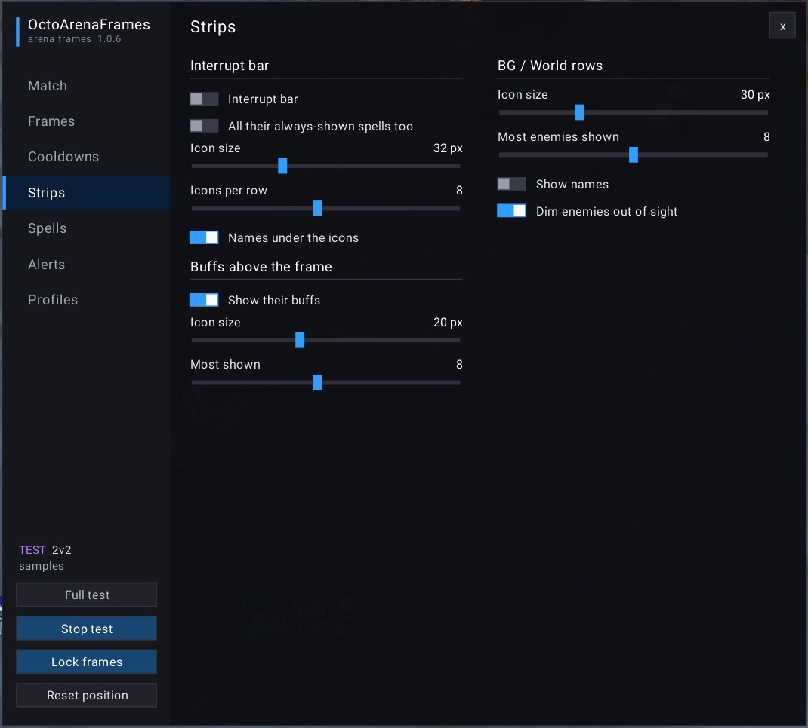
  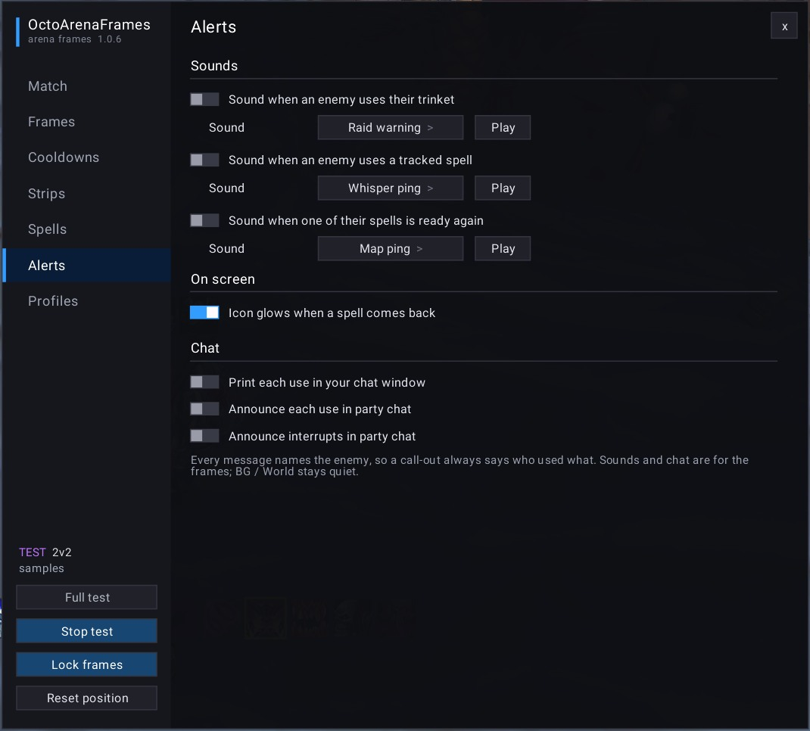
</p>
</details>

## 🔌 DLLs: all optional

It works without any DLLs. With them it sees more, faster.

| DLL | What it adds |
| --- | --- |
| ✅ **SuperWoW** *(recommended)* | Exact tracking and health for every enemy |
| ✅ **nampower** | Instant aura and spell events |
| ✅ **ClassicAPI** | Finds the enemy team by name, cast pushback, focus |
| ➕ **UnitXP** | Fades enemies out of range or line of sight |

Get them all in one click with the
[**Octo DLL Installer**](https://github.com/bdot89/OctoDLLInstaller/releases/latest).

## ⬇️ Install

**🔗 With the OctoWoW launcher (updates itself):** add this git link

```
https://github.com/bdot89/OctoArenaFrames.git
```

**📦 By hand:**

1. Download **OctoArenaFrames-&lt;version&gt;.zip** (under Assets) from the
   [latest release](https://github.com/bdot89/OctoArenaFrames/releases/latest) and unzip it into
   `Interface\AddOns`, so you end up with `Interface\AddOns\OctoArenaFrames\OctoArenaFrames.toc`.
   (Not the green "Code" button: that zip unpacks as `OctoArenaFrames-main`, which the game ignores.)
2. Restart the game fully (a new addon folder is not picked up by `/reload`).
3. If you used OctoKicks, its settings are copied over on first login and a popup offers to switch
   it off.

Then type `/oaf` for the options and `/oaf test` to see the frames.

## ⌨️ Commands

| Command | What it does |
| --- | --- |
| `/oaf` | Options window |
| `/oaf test` | Quick test: sample enemies for 60 seconds, to see and move the frames |
| `/oaf test full` | Full test until you stop it: every frame, casts, kicks with lockouts, CC + DR, cooldowns, trinkets, racials, interrupt bar (also a button in the options) |
| `/oaf lock` | Lock / unlock the frames |
| `/oaf 2v2`, `3v3`, `5v5`, `bg` | Pick a layout (`/oaf auto` to go by the zone) |
| Mouse over a frame + any offensive spell | Goes to that enemy, your target stays (heals and self buffs cast as usual; `/oaf mouse` shows what happened; Options > Frames > Mouseover casting) |
| `/oaf target 1`, `focus 1`, `kick 1` | Act on enemy 1 (also in Key Bindings). The gold number in front of each name is that number: call it on voice ("kill 2") |
| `/oaf log` | What was learned about the enemy team in recent matches |
| `/oaf probe`, `/oaf errors` | Diagnostics for bug reports |
| `/oaf reset` | Reset settings |

## 🐛 Bugs

New addon: tested in game, not yet in many real matches. Please report bugs in
[Issues](https://github.com/bdot89/OctoArenaFrames/issues) with the output of `/oaf probe` and
`/oaf errors` 🙏

## 📝 Notes

- Cooldowns come from `Data\SpellData.lua`, generated from the client's Spell.dbc by
  `tools\BuildSpellData.ps1`.
- Offline tests: `powershell -ExecutionPolicy Bypass -File tests\run.ps1` (needs the OctoBG and
  DmorphOcto test tools next to it).
- Fonts in `media\fonts` are open-licence fonts (Fira Sans, PT Sans, Roboto, Share).
